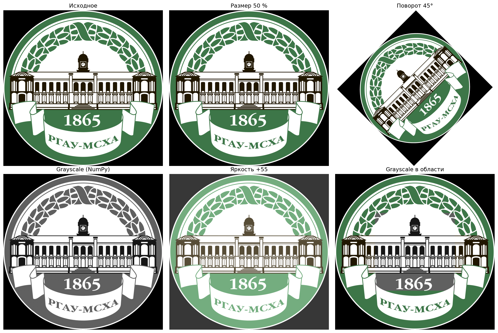

# Практическая работа №1. Обработка изображений

Цель работы — изучить обработку растровых изображений с помощью Pillow, NumPy и Matplotlib. Программа выделяет каналы RGB, меняет яркость и размер, поворачивает изображение, переводит его в оттенки серого и обрабатывает выделенную область. Итоги собираются в композицию.

## Файлы и запуск

Нужны Python, `main.py` и исходное изображение `timka.png` в этой же папке. Установите зависимости в окружение проекта:

```bash
python -m pip install pillow numpy matplotlib
python main.py
```

Запускайте из папки `PZ_01` либо откройте `main.py` в PyCharm и нажмите Run. В консоли введите произвольный угол поворота или нажмите Enter для значения 30°. Готовые изображения сохраняются в `output/`; повторный запуск перезаписывает файлы с теми же именами.

## Пример результата


