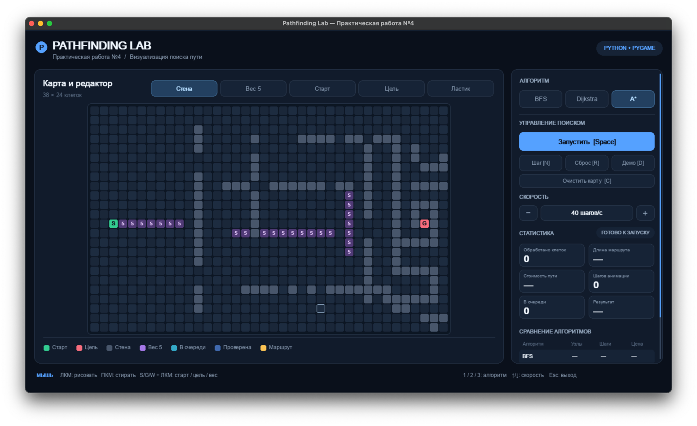

# Практическая работа №4 Визуализация алгоритмов поиска пути

Интерактивное приложение на **Python + PyGame**, визуализирующее поиск пути в сеточном графе с четырьмя направлениями движения.

Реализованы **BFS**, **Dijkstra** и **A\***. Можно расставлять препятствия и клетки с повышенной стоимостью, менять точки старта и финиша, запускать и останавливать поиск, выполнять по одному шагу, менять скорость и сравнивать результаты всех трёх алгоритмов на одной карте.

## Запуск (macOS / Windows / Linux)

Нужен **Python 3.10+**. Откройте каталог `PZ_04` в PyCharm или терминале.

```bash
python -m pip install -r requirements.txt
python main.py
```

Если в системе Python запускается командой `python3` или `py`, используйте эту команду вместо `python`.

В PyCharm: выберите интерпретатор с установленным `pygame`, откройте **`main.py`**, затем нажмите Run. Рабочая директория — папка с `main.py`.

## Управление

| Команда | Действие |
|---|---|
| ЛКМ по клеткам | Рисовать выбранным инструментом (можно тянуть) |
| ПКМ | Стирать стену/вес (можно тянуть) |
| `S` + ЛКМ | Переместить старт |
| `G` + ЛКМ | Переместить цель |
| `W` + ЛКМ | Установить стоимость 5 |
| Кнопки над картой | Выбрать «Стена», «Вес 5», «Старт», «Цель», «Ластик» |
| `1` / `2` / `3` | Выбрать BFS / Dijkstra / A* |
| `Space` | Запуск / пауза / продолжить / перезапустить после завершения |
| `N` | Один шаг поиска или восстановления маршрута |
| `R` | Убрать визуализацию текущего поиска, сохранить карту и сравнение |
| `C` | Очистить стены и веса, сохранить положение старта и цели |
| `D` | Загрузить демонстрационную карту |
| `↑` / `↓` | Ускорить / замедлить поиск |
| Колесо мыши над правой панелью | Прокрутка панели (актуально для компактного окна) |
| `Esc` | Выход |

Окно можно изменять по размеру (минимум 1200×750).

## Обозначения

- **Старт (зелёный):** точка `S`.
- **Цель (красная):** точка `G`.
- **Стена (серая):** недоступная клетка.
- **Вес 5 (фиолетовый):** доступная клетка со стоимостью входа 5.
- **В очереди (бирюзовый):** OPEN, обнаруженные, но ещё не обработанные клетки.
- **Проверена (синий):** CLOSED, уже обработанные клетки.
- **Маршрут (жёлтый):** PATH, восстановленный путь.
- **Белая рамка:** клетка, обработанная на последнем шаге.

Старт и цель никогда не закрашиваются поверх своих цветов. Клетка стоимости 5 может временно отображаться как OPEN, CLOSED или PATH, но её стоимость при этом сохраняется.

## Что показывает сравнение

После завершения запуска в правой панели сохраняется строка выбранного алгоритма: **сколько узлов было обработано, длина найденного пути и его общая стоимость**. Переключите алгоритм клавишами `1`/`2`/`3` и повторите запуск **без изменения карты**, чтобы сравнить результаты. При изменении карты сравнительная таблица очищается, потому что старые показатели уже относятся к другой задаче.

При отсутствии достижимой цели выводится `PATH NOT FOUND`, приложение продолжает работать.

## Принцип работы

- Соседи: только вверх, вниз, влево и вправо. Границы и стены учитываются в `get_neighbors()`.
- BFS: очередь `collections.deque`, оптимизация числа переходов, игнорирование весов при выборе маршрута.
- Dijkstra: приоритетная очередь `heapq` по накопленной стоимости.
- A*: `heapq` по `f = g + h`, `h` — манхэттенское расстояние.
- Обычная клетка стоит 1, взвешенная — 5. Стоимость старта равна нулю, стоимость каждого следующего шага — стоимость клетки назначения.
- Во всех алгоритмах используется `came_from` для восстановления маршрута.
- Каждый алгоритм — **живой генератор**, который выдаёт шаг `SearchStep` во время работы PyGame. Сначала обрабатываются клетки, затем пошагово прорисовывается маршрут. Никакой предварительной записи всей анимации нет.
- Число **обработанных клеток** увеличивается при раскрытии очередной вершины; **шаги анимации** учитывают также прорисовку клеток маршрута.
- Анимация работает отдельно от игрового цикла: интерфейс не блокируется даже при паузе.

## Структура

```text
PZ_04/
├── main.py                 # окно, события, управление и выполнение генератора
├── algorithms.py           # BFS / Dijkstra / A* / восстановление маршрута
├── grid.py                 # клетки, веса, соседи, редактирование
├── visualizer.py           # UI и отрисовка
├── settings.py             # цвета, размеры и скорость
├── requirements.txt        # pygame
├── README.md               # инструкция
├── tests/
│   └── test_algorithms.py  # автоматические тесты
└── screenshots/            # папка для скриншотов при сдаче
```

`algorithms.py` **не импортирует PyGame**.

## Тестирование

```bash
python -m unittest discover -s tests -v
```

Проверяются все шесть обязательных ситуаций из задания: соседние точки, пустая карта, несколько маршрутов, цель в окружении стен, дорогой короткий и дешёвый длинный путь, удалённые точки. Дополнительно проверяется логика изменения карты, корректность эвристики, демонстрационная карта и реальная поэтапная выдача событий генератором.

## Скриншоты


