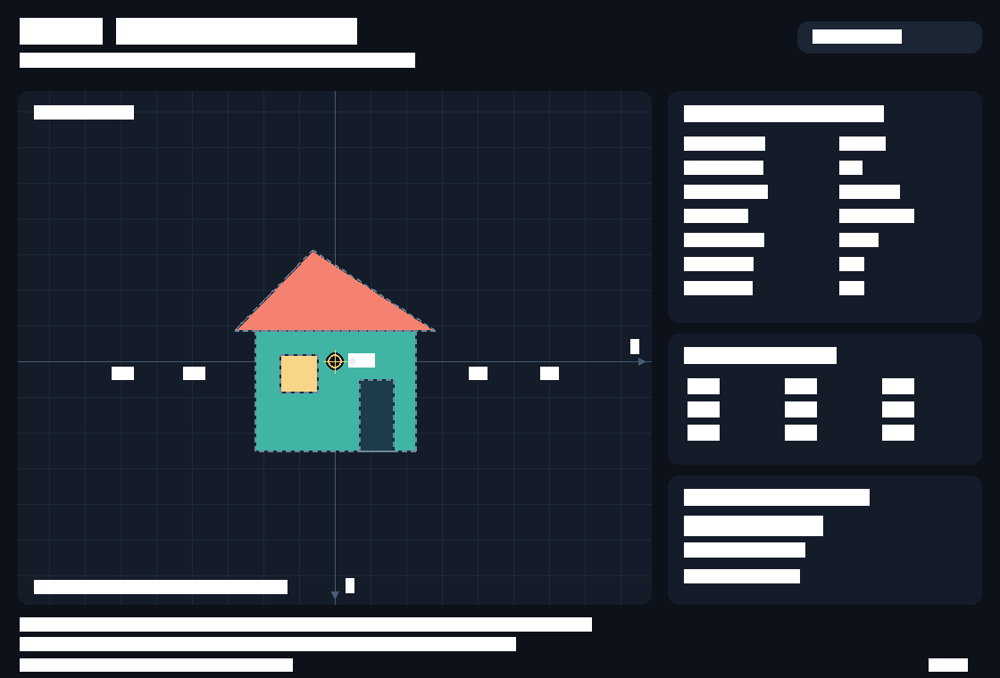
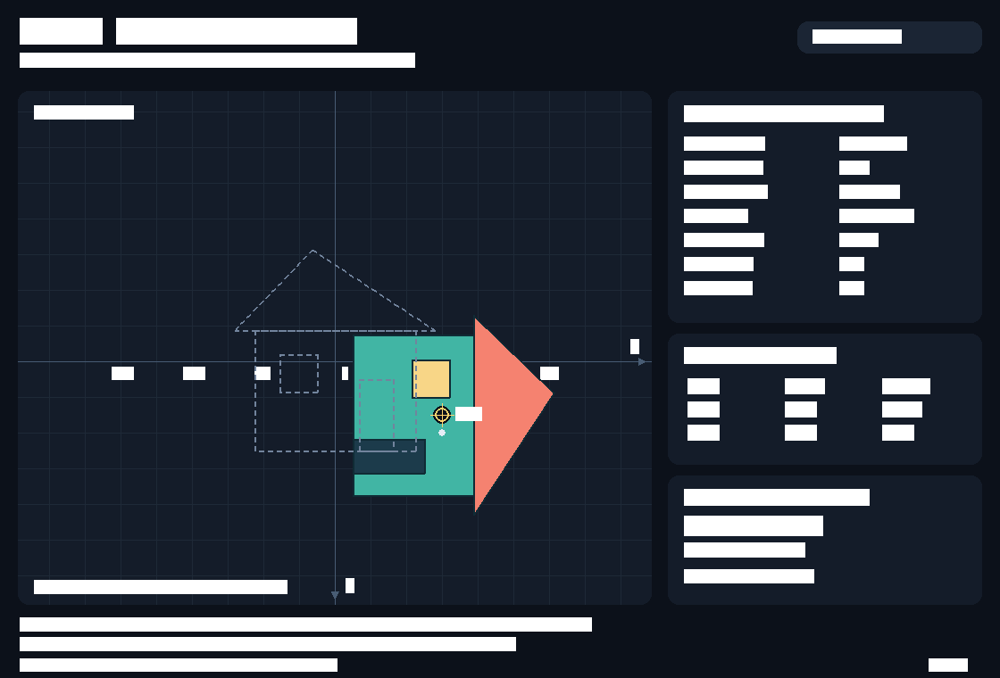
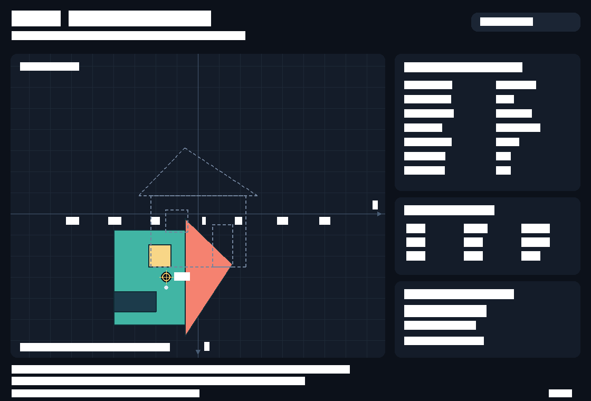

# ПЗ №5 — Affine Transform Studio

Интерактивный редактор аффинных преобразований составной векторной фигуры.
Цель работы — связать локальные координаты, матрицы 3×3, композицию
преобразований и обратное преобразование курсора. Выполнены все 10 обязательных
заданий преподавателя; исходные учебные документы сохранены.

## Установка и запуск

Используется **Python 3.11** и существующее окружение `.venv` в корне `PC_Graphics`.
Команды из корня репозитория:

```bash
cd /Users/fworld/PycharmProjects/PC_Graphics
.venv/bin/python -m pip install -r PZ_05/requirements.txt
cd PZ_05
../.venv/bin/python main.py
```

В PyCharm выберите интерпретатор `PC_Graphics/.venv/bin/python` и запустите
`PZ_05/main.py`. Программа не зависит от текущего рабочего каталога.
Зависимости: NumPy, PyGame **2.6.1**, pytest для тестов.

Окно автоматически подбирает начальный размер по доступному дисплею.
При изменении размера весь интерфейс пропорционально масштабируется, сохраняя
панель и подсказки. Пустые поля по краям не принимают щелчки сцены; координаты
мыши сначала пересчитываются в логическое пространство интерфейса 1120×760.
Очень маленькое окно можно растянуть для удобного чтения.

## Управление

Клавиши указаны для латинской раскладки клавиатуры.

| Клавиши | Действие |
|---|---|
| Стрелки | Перенос по X/Y, 160 единиц/с |
| Q / E | Поворот −/+70°/с |
| Z / X | Уменьшить / увеличить масштаб X |
| A / D | Уменьшить / увеличить масштаб Y |
| H | Отражение относительно локальной вертикальной оси: x → −x |
| V | Отражение относительно локальной горизонтальной оси: y → −y |
| J / L | Уменьшить / увеличить горизонтальный shear |
| U / O | Уменьшить / увеличить вертикальный shear |
| P + ЛКМ на сцене | Установить локальный pivot через обратную матрицу |
| ЛКМ на сцене | Выделить домик по силуэту; щелчок мимо снимает выделение |
| M | Переключить режим композиции A/B |
| R | Сбросить параметры, pivot, режим и выделение |
| F1 | Загрузить обязательный пример: перенос (120, 60), угол +90° |
| Esc / закрытие окна | Завершить приложение |

Преобразования доступны постоянно, в том числе без выделения. Выделение
подсвечивает границы золотым цветом. Пунктирный нейтральный контур обозначает
неподвижную исходную фигуру, крест с кольцом — pivot, белая точка — образ
локальной точки `(20, 0)`. Панель показывает её текущие мировые координаты.

Удерживаемые клавиши обрабатываются с `dt`; при потере фокуса преобразования
приостанавливаются. Задержка одного кадра ограничена 0.1 с, чтобы возврат после
паузы не вызывал скачок. Переключатели H/V/M/R/F1 выполняются по KEYDOWN.

## Структура файлов

```text
PZ_05/
├── main.py                    # окно, события, непрерывный ввод, dt
├── transformations.py         # чистая математика без PyGame
├── objects.py                 # исходные полигоны, параметры, hit-test
├── renderer.py                # сетка, оси, фигура, панель, масштабирование UI
├── settings.py                # палитра, размеры, скорости, диапазоны
├── requirements.txt           # зависимости программы и тестов
├── screenshots/               # реальные кадры графического окна
├── Задание для студентов.md   # Пзшка
├── Теоретическая сводка.md    # Пзшка но другая
└── README.md
```

Домик состоит из четырёх многоугольников: корпус, несимметричная крыша,
смещённая вправо дверь и окно. Вершины — неизменяемые NumPy-массивы `float64`.
Новые координаты каждый кадр вычисляются из оригинала; PNG используется
только для снимков результата, а не для геометрии.

## Математическая модель

Используются однородные координаты, векторы-столбцы и умножение `@`.
X направлена вправо, Y вниз. Положительный угол визуально вращает по часовой
стрелке. Массив вершин хранится строками N×2 и преобразуется как `(M @ P_h.T).T`.
Округление применяется только при выводе чисел и растеризации.

```text
T(tx,ty) = [ 1  0 tx ]      S(sx,sy) = [ sx  0  0 ]
           [ 0  1 ty ]                 [  0 sy  0 ]
           [ 0  0  1 ]                 [  0  0  1 ]

R(a) = [ cos(a) -sin(a) 0 ]    H(kx,ky) = [ 1 kx 0 ]
       [ sin(a)  cos(a) 0 ]               [ ky 1 0 ]
       [   0       0   1 ]               [ 0  0 1 ]

Fh = diag(-1, 1, 1)        Fv = diag(1, -1, 1)
```

В коде угол задаётся в градусах. `shear_x(k)` и `shear_y(k)` реализуют отдельные
сдвиги. В общей композиции используется **одновременный** `H(kx, ky)`, а не
последовательное произведение Hx @ Hy: это разные матрицы при двух ненулевых
коэффициентах.

Для локального pivot `p`, отражений `F` и деформации `D`:

```text
D  = H @ S @ F
Dp = T(p) @ D @ T(-p)
Rp = T(p) @ R @ T(-p)

A: M = T(tx,ty) @ Rp @ Dp
B: M = Rp @ T(tx,ty) @ Dp

p_screen = V @ M @ p_local
V = T(начало координат сцены)
```

В режиме A формула равна модели теоретической сводки:
`T(tx,ty) @ T(p) @ R @ H @ S @ F @ T(-p)`.
При M меняются местами только перенос и вращение; остальные параметры сохраняются.
При отсутствии переноса `M @ p = p` в обоих режимах, включая ненулевые масштаб,
отражения и shear. При чистом вращении расстояния от pivot до вершин сохраняются.
При ненулевом переносе в A образ pivot равен `p + t`, в B — `p + R @ t`:
в B перенос выполняется перед вращением, поэтому перенесённый объект движется
вокруг центра вращения. Маркер всегда рисуется в `V @ M @ p` и соответствует
фактической геометрии. Панель показывает **M**, без экранного смещения **V**.

### Обязательный пример порядка операций

Нажмите **F1**, затем **M**. Остальные преобразования нейтральны, pivot `(0, 0)`.

| Точка | Перенос | Поворот | Режим A: T @ R | Режим B: R @ T |
|---|---|---|---|---|
| (20, 0) | (120, 60) | +90° | **(120, 80)** | **(−60, 140)** |

Оба результата проверяются автоматически, отображаются числами и белой точкой
на сцене. Вернуться к исходному состоянию — **R**.

### Pivot и точное выделение

После пересчёта курсора из пикселей окна в логический интерфейс применяется
`(V @ M)⁻¹`. Локальная точка проверяется алгоритмом ray casting на попадание
в любой исходный многоугольник. Граница включается в фигуру с допуском `1e-8`.
Пустые области ограничивающего прямоугольника не выделяют объект.
Для P + ЛКМ та же обратная матрица **до изменения pivot** задаёт его локальные
координаты; щелчок может быть в любой точке сцены. Изменение центра при ненулевом
угле/деформации может сразу изменить положение объекта — это пересчёт из
исходных вершин с новым центром.

Масштаб ограничен `[0.2, 4.0]`, shear — `[-0.8, 0.8]`.
Следовательно, `det(H) = 1 − kx·ky ≥ 0.36`, а `|det(M)| ≥ 0.0144`.
Перенос ограничен ±10000 единиц для устойчивой растеризации.
Перед инверсией проверяются конечность чисел, `|det| ≥ 1e-10` и
`cond(M) ≤ 1e12`; сбой инверсии безопасно снимает выделение и показывает сообщение.

## Соответствие обязательным заданиям

| № | Реализация |
|---|---|
| 1 | Окно с заголовком, главный цикл, Clock, сетка, X/Y, начало координат, Esc |
| 2 | Четыре NumPy-полигона; исходный пунктир и цветной результат |
| 3 | translation, scale, rotation; float64 3×3, однородные столбцы, @ |
| 4 | Все заданные клавиши, dt, ограничения масштаба |
| 5 | Правая панель параметров и M 3×3 с двумя десятичными знаками |
| 6 | Режимы A/B, сохранение дополнительных преобразований, пример по F1 |
| 7 | Локальный pivot, P + ЛКМ, обратная матрица, T(p) @ R @ T(-p), маркер |
| 8 | Оба отражения и shear, ограничения, обратимая композиция |
| 9 | Обратная (V @ M), проверка по исходным полигонам, подсветка, защита инверсии |
| 10 | Все 12 сценариев и дополнительные тесты, проверка графического запуска |


## Снимки приложения




