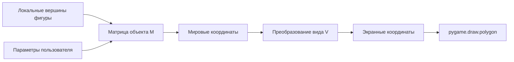
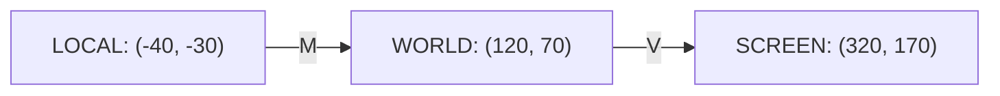
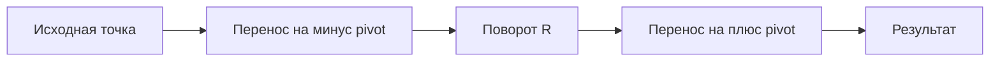
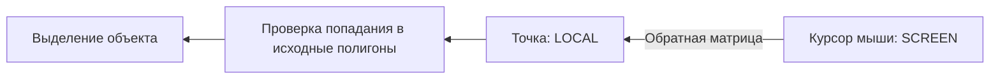

# Теоретическая сводка к практической работе № 5

---

## 1. Что именно предстоит моделировать

Редактор получает геометрическую фигуру – например, «домик» из многоугольников. Ее вершины заданы **один раз в локальных координатах**. Пользователь меняет параметры: положение, угол, масштаб, отражение, сдвиг, опорную точку. Приложение вычисляет матрицу преобразования и отображает результат.



**Текстовая версия схемы:** исходные вершины → матричные вычисления → координаты для отрисовки → графическое изображение. При изменении параметров пересчитываются преобразованные координаты; исходные вершины не переписываются.

Принципиальная граница ответственности:

- **NumPy и математические функции** вычисляют новые координаты.
- **PyGame** получает координаты, рисует фигуру и обрабатывает ввод.
- **Модель объекта** хранит геометрию и параметры, но не управляет FPS или дисплеем.

### Почему не ограничиться `pygame.transform.rotate()`?

Этот метод изменяет растровый `Surface`, а цель задания – понять, **как координаты вершин преобразуются матрицей**. Поэтому основную фигуру следует рисовать как многоугольники. Работа с `pygame.transform` полезна позднее как сравнение векторной и растровой графики, но не заменяет матричные вычисления.

---

## 2. Три системы координат

**Локальные координаты (local)** – вершины относительно собственной точки отсчета объекта. Например, «домик» располагается около `(0, 0)`. Эти значения остаются неизменными при движении объекта.

**Мировые координаты (world)** – положение преобразованного объекта на общей сцене.

**Экранные координаты (screen)** – пиксели окна PyGame, в которых работает отрисовка и поступают события мыши.



Для работы примем **единую 2D-конвенцию: X вправо, Y вниз**, как у PyGame. В таком случае положительный угол в привычной матрице вращения визуально соответствует повороту **по часовой стрелке**. Это отличается от знака угла в `pygame.transform.rotate()`, у которого положительный угол означает поворот против часовой стрелки.

В самом простом случае экранное преобразование лишь добавляет смещение начала координат:

$$
V=\begin{bmatrix}1&0&o_x\\0&1&o_y\\0&0&1\end{bmatrix}.
$$

Тогда точка с мировыми координатами `(120, 70)` при экранном начале `(200, 100)` будет нарисована в `(320, 170)`.

**Практический вывод:** не следует хранить у объекта только экранные координаты. Иначе изменение начала сцены и обратная обработка мыши начинают затрагивать всю бизнес-логику геометрии.

---

## 3. Как выглядит исходная фигура

Чтобы вращение и отражение были заметны, удобнее использовать **несимметричный объект**, а не квадрат.

Пример объекта «домик»: тело, крыша и дверь. Все многоугольники задаются относительно одного локального начала.

```text
            y отрицательное (вверх)
                       ↑
                       |
                    /\ |         крыша
                   /  \|
             _____/____\_____
             |             |
             |      __     |       корпус
             |     |  |    |
             |_____|__|____|
                       +------------→ x
                    локальное (0,0)
```

Пример данных для одного многоугольника:

```python
import numpy as np

body = np.array(
    [
        [-50.0, -25.0],
        [ 50.0, -25.0],
        [ 50.0,  45.0],
        [-50.0,  45.0],
    ],
    dtype=float,
)
```

Отдельно создаются треугольник крыши и многоугольник двери. Не нужно собирать все в один сложный контур: один объект вполне может состоять из нескольких многоугольников, преобразуемых **одной и той же матрицей**.

---

## 4. Зачем нужна третья координата

Обычная двумерная точка имеет координаты `(x, y)`. Для переноса удобно добавить формальную третью координату `1`:


$$
\mathbf{p} =
\begin{bmatrix}
x \\
y \\
1
\end{bmatrix}
$$


Это **однородные координаты**. Теперь перенос, масштаб, вращение, отражение и сдвиг описываются матрицами одного размера – 3×3:


$$
\mathbf{p}' = M\mathbf{p}
$$


Используем **векторы-столбцы** и умножаем матрицу **слева**. От этой договоренности зависит порядок операций.

Пример:

```python
point = np.array([20.0, 10.0, 1.0])

matrix = np.array([
    [1.0, 0.0, 120.0],
    [0.0, 1.0,  60.0],
    [0.0, 0.0,   1.0],
])

print(matrix @ point)  # [140.  70.   1.]
```

Оператор `@` – матричное умножение, а не поэлементное. Применять `matrix * point` для этой задачи неправильно.

---

## 5. Перенос – translation

Матрица перемещения на `(t_x, t_y)`:

$$
T(t_x,t_y)=\begin{bmatrix}
1&0&t_x\\
0&1&t_y\\
0&0&1
\end{bmatrix}.
$$

```python
def translation(tx, ty):
    return np.array([
        [1.0, 0.0, tx],
        [0.0, 1.0, ty],
        [0.0, 0.0, 1.0],
    ])
```

Например, `(20, 10)` после переноса на `(120, 60)` станет `(140, 70)`.

```text
До:   • (20,10)
                   → перенести на (120,60)
После:                          • (140,70)
```

Перенос не изменяет размеры фигуры и взаимные расстояния между ее точками.

---

## 6. Масштаб – scale

$$
S(s_x,s_y)=\begin{bmatrix}
s_x&0&0\\
0&s_y&0\\
0&0&1
\end{bmatrix}.
$$

Пример: точка `(20, 10)` при `s_x=2`, `s_y=0.5` перейдет в `(40, 5)`.

```text
Исходный прямоугольник      После S(2, 0.5)
┌──────┐                    ┌────────────┐
│      │          →         │            │
│      │                    └────────────┘
└──────┘
```

Масштабирование с разными коэффициентами **не сохраняет углы и пропорции**. Масштабирование с коэффициентом `0` делает матрицу необратимой. Для задания, где требуется обратное преобразование мыши, нужно запрещать нулевой и практически нулевой масштаб.

Отрицательный коэффициент по одной оси вызывает отражение и одновременно изменение масштаба. Для наглядности в редакторе лучше иметь отдельные команды «Scale» и «Reflect».

---

## 7. Поворот – rotation

При использовании столбцов:

$$
R(\theta)=\begin{bmatrix}
\cos\theta&-\sin\theta&0\\
\sin\theta&\cos\theta&0\\
0&0&1
\end{bmatrix}.
$$

```python
import math

def rotation(angle_degrees):
    angle = math.radians(angle_degrees)
    c, s = math.cos(angle), math.sin(angle)
    return np.array([
        [c, -s, 0.0],
        [s,  c, 0.0],
        [0.0, 0.0, 1.0],
    ])
```

**Численный пример:** `(20, 0)` после поворота на `+90°` вокруг `(0,0)` станет `(0, 20)`.

```text
Экранная система: +Y вниз

(0,0) ●──────────→ • (20,0)
      │
      │  +90°
      ↓
      • (0,20)
```

У `pygame.transform.rotate(surface, angle)` положительный угол означает противоположное визуальное направление – это следствие принятого интерфейса функции и экранной системы координат. Не смешивайте правила знака при сравнении двух методов.

---

## 8. Отражение – reflection

Отражение относительно вертикальной оси объекта (`x` меняет знак):

$$
F_x=\begin{bmatrix}-1&0&0\\0&1&0\\0&0&1\end{bmatrix}.
$$

Отражение относительно горизонтальной оси (`y` меняет знак):

$$
F_y=\begin{bmatrix}1&0&0\\0&-1&0\\0&0&1\end{bmatrix}.
$$

```text
Зеркало по вертикали (относительно x=0)

  ◁       │       ▷
  x<0     │       x>0
          │
          │ ось отражения
```

**Важно:** отражение относительно локальной оси объекта и отражение относительно мировой оси могут дать разные результаты, если объект уже повернут или перенесен.

---

## 9. Сдвиг – shear

Горизонтальный сдвиг:

$$
H_x(k)=\begin{bmatrix}1&k&0\\0&1&0\\0&0&1\end{bmatrix}
\quad\Rightarrow\quad x'=x+ky,\quad y'=y.
$$

Вертикальный сдвиг:

$$
H_y(k)=\begin{bmatrix}1&0&0\\k&1&0\\0&0&1\end{bmatrix}
\quad\Rightarrow\quad x'=x,\quad y'=kx+y.
$$

```text
До shear                 После shear по X

┌────────┐                ╱────────╱
│        │      →        ╱        ╱
│        │              ╱        ╱
└────────┘             ╱────────╱
```

Для горизонтального shear с `k=0.5` точка `(20, 40)` станет `(40, 40)`, потому что `20 + 0.5·40 = 40`.

При одновременном shear по X и Y матрица может стать вырожденной: определитель ее линейной части равен `1 - k_x·k_y`. В редакторе разумно ограничить коэффициенты, например диапазоном `[-0.8; 0.8]`.

---

## 10. Композиция матриц: порядок операций принципиален

**Композиция** позволяет заменить последовательность преобразований одной матрицей. Но порядок умножения имеет значение.

Для векторов-столбцов:

$$
\mathbf p' = T\,R\,\mathbf p
$$

означает: **сначала** применить `R`, **затем** `T`.

И наоборот:

$$
\mathbf p' = R\,T\,\mathbf p
$$

означает: **сначала** применить `T`, **затем** `R`.

### Два режима на одном численном примере

Пусть исходная точка `(20, 0)`, перенос `(120, 60)`, поворот `+90°`.

| Порядок | Матрица | Итоговая точка |
|---|---|---|
| Вращение → перенос | `T @ R` | `(120, 80)` |
| Перенос → вращение | `R @ T` | `(-60, 140)` |

```text
Исходная точка  (20,0)
       │
       ├── R(90°) → (0,20) ── T(120,60) ──→ (120,80)
       │
       └── T(120,60) → (140,60) ── R(90°) ──→ (-60,140)
```

Проверяем через NumPy:

```python
point = np.array([20.0, 0.0, 1.0])
T = translation(120.0, 60.0)
R = rotation(90.0)

print(np.round((T @ R) @ point, 6))
print(np.round((R @ T) @ point, 6))
```

Этот пример необходимо **отобразить в редакторе двумя режимами**, чтобы студент увидел отличие не только в числах, но и в положении объекта на сцене.

---

## 11. Поворот вокруг произвольной точки – pivot

Обычный `R(θ)` вращает объект вокруг локального `(0,0)`. Но в редакторе пользователь должен уметь задавать произвольный **pivot** – опорную точку.

Идея состоит из трех операций:

1. перенести pivot в начало координат;
2. выполнить вращение;
3. вернуть pivot на прежнее место.

$$
M_{pivot}=T(p_x,p_y)\;R(\theta)\;T(-p_x,-p_y).
$$



**Проверочный пример:** pivot `(100, 100)`, точка `(140, 100)`, угол `+90°`. Результат – `(100, 140)`.

Если сделать просто `R @ T` без пары компенсационных переносов, объект начнет вращаться вокруг другого центра или «летать» по сцене.

Для масштаба вокруг pivot применяется аналогичная композиция:

$$
M=T(p_x,p_y)\;S(s_x,s_y)\;T(-p_x,-p_y).
$$

---

## 12. Как объединить все параметры редактора

Рассмотрим согласованную модель параметров:

- локальная геометрия объекта `P_local`;
- локальный pivot `p`;
- угол `θ`;
- коэффициенты масштаба `sx, sy`;
- отражения `Fx/Fy`;
- shear `H`;
- положение/перенос объекта `tx, ty`.

Один из **явно выбранных** вариантов композиции:

$$
L=T(p)\;R(\theta)\;H\;S\;F\;T(-p),
$$

$$
M_{world}=T(t_x,t_y)\;L.
$$

Читаем справа налево: сначала возвращаем вершину относительно pivot, затем применяем отражение, масштаб, сдвиг, поворот, возвращаем pivot и в конце переносим объект в мировую позицию.

Для наглядного сравнения порядка достаточно временно отключить `H`, `S`, `F` и выбрать pivot `(0,0)`, затем переключать:

```python
mode_a = T @ R  # вращение, затем перенос
mode_b = R @ T  # перенос, затем вращение
```

**Важный инженерный принцип:** не «добавляйте» матрицу поворота к уже измененным вершинам на каждом кадре. Храните исходную геометрию и заново вычисляйте композицию из **текущих параметров**. Это предотвращает накопление ошибок округления и делает сброс точным.

---

## 13. Преобразование нескольких вершин с NumPy

Если многоугольник представлен как массив `N×2` (каждая строка – `(x,y)`), сначала добавляем столбец единиц:

```python
points = np.array([
    [-40.0, -20.0],
    [ 40.0, -20.0],
    [ 40.0,  30.0],
    [-40.0,  30.0],
])

ones = np.ones((len(points), 1))
points_h = np.hstack((points, ones))    # форма N×3
```

Теперь умножаем матрицу на все вершины сразу:

```python
transformed_h = (matrix @ points_h.T).T  # форма N×3
transformed = transformed_h[:, :2]       # форма N×2
```

Обращайте внимание на транспонирование: в теории точка – столбец `3×1`, а в массиве NumPy точки по соглашению хранятся **в строках**.

Проверять форму данных удобно через:

```python
print(points.shape)       # (4, 2)
print(points_h.shape)     # (4, 3)
print(transformed.shape)  # (4, 2)
```

**Где округлять?** Вычисления выполняются с `float`. Преобразовывать координаты к `int` или округлять следует только непосредственно перед отрисовкой; при хранении геометрии округление на каждом кадре недопустимо.

---

## 14. От NumPy до `pygame.draw.polygon()`

PyGame умеет рисовать многоугольник по списку точек:

```python
pygame.draw.polygon(
    screen,
    (70, 130, 205),
    [(100, 80), (160, 80), (160, 140), (100, 140)],
)
```

Принцип визуализации трансформированного объекта:

```text
локальные вершины N×2
        ↓ добавить единицы
однородные координаты N×3
        ↓ применить M_world
мировые вершины
        ↓ применить V
экранные вершины
        ↓ отрисовать
pygame.draw.polygon(...)
```

```python
screen_points = [
    (int(round(x)), int(round(y)))
    for x, y in transformed_screen_points
]

pygame.draw.polygon(screen, color, screen_points)
```

Для домика нужно повторить процедуру для каждого исходного многоугольника, используя **одну матрицу** `M_world`. Функция отрисовки не должна менять параметры преобразования или вершины объекта.

**Практический совет:** храните исходную геометрию в отдельном объекте/списке полигонов; у каждого полигона можно хранить собственный цвет. В методе `draw()` преобразуйте и рисуйте, не модифицируя оригинал.

---

## 15. Показ текущей матрицы 3×3 в интерфейсе

Матрица должна отображаться одновременно с объектом – иначе пользователь видит движение, но не замечает его математическую причину.

Например:

```text
┌─────────────────────────────┐
│ CURRENT TRANSFORM           │
│                             │
│  1.083   -0.625   120.000  │
│  0.625    1.083    60.000  │
│  0.000    0.000     1.000  │
└─────────────────────────────┘
```

Форматировать числа можно так:

```python
label = f"{matrix[row, col]:8.3f}"
```

`font.render()` создает Surface с текстом, затем `screen.blit()` помещает его на экран. Можно показывать параметры `tx, ty, θ, sx, sy, shear_x, shear_y` и текущий режим композиции.

Не округляйте саму матрицу до трех знаков перед расчетами: округляется **только текстовое представление**.

---

## 16. Обратное преобразование и мышь

Важная часть задания: **выбрать фигуру щелчком по ее видимому изображению**, даже если она повернута, отражена или смещена.

`event.pos` дает координаты мыши **на экране**. Но исходные полигоны описаны **в локальной системе**. Поэтому нужно перевести курсор обратно:

$$
p_{screen}=V\,M_{world}\,p_{local}.
$$

Следовательно:

$$
p_{local}=(V\,M_{world})^{-1}p_{screen}.
$$



Небольшой численный пример:

```python
M = translation(120, 60) @ np.diag([2.0, 2.0, 1.0])

local_point = np.array([10.0, 5.0, 1.0])
screen_point = M @ local_point  # [140., 70., 1.]

recovered = np.linalg.inv(M) @ screen_point
# [10., 5., 1.]
```

Здесь для простоты `V` – единичная матрица. Если на сцене есть экранный сдвиг `V`, нужно инвертировать **полную композицию** `V @ M`.

**Нельзя** получить корректный hit-test повернутого домика проверкой одного `pygame.Rect`, ограничивающего его изображение: прямоугольник может содержать пустые области. В этой работе попадание проверяется по исходным многоугольникам после обратного преобразования курсора.

---

## 17. Как проверить точку на принадлежность многоугольнику

Один из стандартных способов – алгоритм пересечения горизонтального луча (*ray casting*):

1. Из проверяемой точки мысленно проводим луч вправо.
2. Считаем число пересечений с ребрами многоугольника.
3. Нечетное число – точка внутри, четное – снаружи.

```text
  многоугольник
      __________
     /          \
    /    •-------→→→→ луч вправо
    \           /
     \_________/

«•» – точка проверки
```

Псевдокод:

```text
inside = False
для каждого ребра (A, B):
    если горизонтальная прямая через P пересекает ребро:
        найти координату пересечения x_intersection
        если x_intersection > P.x:
            inside = not inside
вернуть inside
```

Критерий пересечения по вертикали обычно записывают:

```python
(y1 > py) != (y2 > py)
```

а координату пересечения так:

```python
x_intersection = x1 + (py - y1) * (x2 - x1) / (y2 - y1)
```

Деление безопасно **внутри указанного условия**, поскольку горизонтальное ребро под него не подпадает. Для точек точно на границе следует отдельно выбрать и документировать правило: считать их внутри с некоторым допуском или вне. Для «домика» с несколькими полигонами достаточно попадания **в любой** из них.

Оценка сложности проверки – `O(k)` по количеству вершин многоугольника. Для учебной сцены с несколькими небольшими контурами этого достаточно.

---

## 18. Почему некоторые матрицы нельзя обратить

Для обратного преобразования необходима невырожденная матрица:

$$
\det(M)\ne0.
$$

Частый пример ошибки – масштаб `sx=0`: объект схлопывается в линию; невозможно восстановить исходную координату X по экранной точке.

```python
import numpy as np

try:
    inverse = np.linalg.inv(matrix)
except np.linalg.LinAlgError:
    # Некорректные параметры: например, нулевой масштаб.
    inverse = None
```

Для устойчивости редактора следует:

- ограничить масштаб диапазоном, например `[0.2; 4.0]` по модулю;
- исключить вырожденные комбинации shear;
- хранить преобразования в `float64`;
- не выполнять инверсию, если определитель близок к нулю;
- не допускать падения программы на некорректном параметре.

Важно: очень маленький, но ненулевой определитель также может привести к численной нестабильности. Не сводите проверку только к `det == 0`.

---

## 19. Зачем нужен `dt` и как отделить ввод от рисования

Матрица не требует выполнять вычисления с фиксированной частотой; ее можно пересчитывать при изменении параметров. Однако **непрерывный ввод** (удержание клавиши для переноса/вращения) лучше делать независимым от FPS.

```python
clock = pygame.time.Clock()

while running:
    dt = clock.tick(60) / 1000.0

    # события
    # обновление параметров с учетом dt
    # вычисление матрицы из текущих параметров
    # отрисовка
    pygame.display.flip()
```

Например, линейное перемещение на `150 пикселей/с` за кадр с `dt=0.02` должно менять параметр переноса на `3 пикселя`, а не на постоянные `150`.

Функции `draw_grid()`, `draw_object()`, `draw_ui()` не должны изменять состояние объекта: **render показывает данные, update изменяет их**.

---

## 20. Архитектура, удобная для учебной проверки

```text
transform_editor/
├── main.py               # окно, события, управление, главный цикл
├── transformations.py    # чистые матрицы 3×3, без pygame
├── objects.py            # локальные полигоны и параметры фигуры
├── renderer.py           # сетка, объект, pivot, UI
├── settings.py           # окно, цвета, скорости, ограничения
└── README.md
```

В `transformations.py` уместны функции:

```python
translation(tx, ty)
rotation(angle_degrees)
scale(sx, sy)
reflection(axis)
shear(kx, ky)
around_pivot(transform_matrix, pivot)
transform_points(points, matrix)
```

`main.py` отвечает за связь этих частей, но не должен содержать всю линейную алгебру внутри обработчика `KEYDOWN`.

---

## 21. Проверочные примеры, которые полезно разобрать до программирования

| Ситуация | Ожидаемый результат |
|---|---|
| `T(120,60)` для `(20,10)` | `(140,70)` |
| `S(2,0.5)` для `(20,10)` | `(40,5)` |
| `R(+90°)` для `(20,0)` | `(0,20)` при Y вниз |
| `Hx(0.5)` для `(20,40)` | `(40,40)` |
| `T @ R` для `(20,0)` | `(120,80)` при T(120,60), R(+90°) |
| `R @ T` для `(20,0)` | `(-60,140)` при тех же T, R |
| Вращение вокруг pivot | pivot не сдвигается самим вращением |
| `M⁻¹ @ (M @ p)` | возвращает исходное `p` с численной точностью |

Самопроверка NumPy:

```python
import numpy as np

p = np.array([20.0, 0.0, 1.0])
T = translation(120.0, 60.0)
R = rotation(90.0)

assert np.allclose((T @ R) @ p, [120.0, 80.0, 1.0])
assert np.allclose((R @ T) @ p, [-60.0, 140.0, 1.0])
assert np.allclose(np.linalg.inv(T @ R) @ ((T @ R) @ p), p)
```

`np.allclose()` предпочтительнее строгого `==` для результатов с плавающей точкой.

---

## 22. Типичные ошибки и их признаки

| Ошибка | Как проявляется | Что проверять |
|---|---|---|
| Неправильный порядок `T @ R` | объект «уезжает» после поворота | порядок применения справа налево |
| Перемножение через `*` | странные массивы, неверные координаты | использовать `@` |
| Повторные изменения исходных вершин | постепенно ухудшается форма | пересчитывать из исходной геометрии |
| `int` до вычислений | дрожание и накопление ошибок | округлять только при рисовании |
| Несогласованное направление Y | поворот в «не ту» сторону | зафиксировать экранную конвенцию |
| Масштаб `0` | невозможна инверсия матрицы | ограничения параметров и проверка det |
| Hit-test через Rect | выбор фигуры по пустому фону | обратное преобразование + polygon test |
| Перепутанные `row/col` и `x/y` | неверное положение вершин | явные названия переменных |
| Рисование изменяет объект | скачки при обновлении окна | разделить update и draw |

---

## 23. Минимальный технический справочник

| Задача | Средство |
|---|---|
| Создать матрицу | `np.array(..., dtype=float)` |
| Единичная матрица | `np.eye(3)` |
| Перемножить матрицы | `A @ B` |
| Транспонировать массив точек | `points.T` |
| Добавить третий столбец | `np.hstack(...)` |
| Обратная матрица | `np.linalg.inv(M)` |
| Проверить численный результат | `np.allclose(...)` |
| Перевести градусы в радианы | `math.radians(...)` |
| Нарисовать многоугольник | `pygame.draw.polygon(...)` |
| Нарисовать оси/линию | `pygame.draw.line(...)` |
| Показать координаты/матрицу | `font.render(...)`, `screen.blit(...)` |
| Получить координаты мыши | `event.pos` |
| Измерить `dt` | `pygame.time.Clock().tick()` |

---

## 24. Обобщение

Главная модель редактора:

$$
\boxed{p_{screen}=V\,M_{world}\,p_{local}}
$$

Для обработки курсора:

$$
\boxed{p_{local}=(V\,M_{world})^{-1}p_{screen}}
$$

Практическая ценность заключается не в том, чтобы показать красивое вращение, а в умении **разделять систему координат, математическую модель и графическое представление**. Эти же принципы используются в редакторах схем, CAD/GIS-приложениях, 2D-движках, визуальных конструкторах и интерфейсах с масштабированием и панорамированием.

---

## Рекомендуемые источники

1. Боресков А. В., Шикин Е. В. **Компьютерная графика**. 2022. Рекомендуемая литература дисциплины.
2. Чернышев С. А. **Компьютерная графика**. 2022. Рекомендуемая литература дисциплины.
3. Pygame Documentation – Drawing: https://www.pygame.org/docs/ref/draw.html
4. Pygame Documentation – Transform: https://www.pygame.org/docs/ref/transform.html
5. Pygame Documentation – Rect, Events, Time: https://www.pygame.org/docs/
6. NumPy Documentation – Linear algebra: https://numpy.org/doc/stable/reference/routines.linalg.html
7. NumPy Documentation – Inverse matrix: https://numpy.org/doc/stable/reference/generated/numpy.linalg.inv.html
